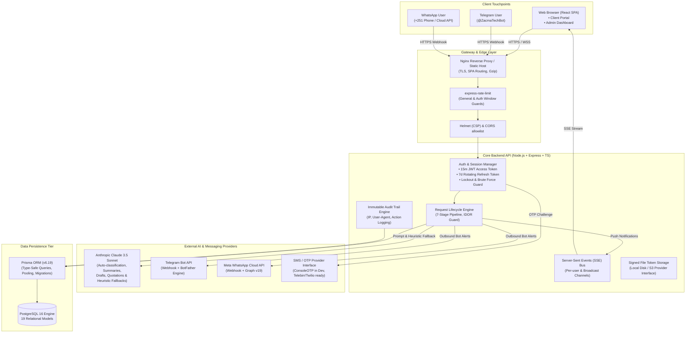

# System Architecture & Technical Specifications

This document outlines the architectural blueprint, data flow, security model, and integration pipelines of the **AI-Powered Customer Request & Feedback Management System** built for **Zacma Technologies**.

---

## 1. High-Level System Architecture



---

## 2. Monorepo Structure

```
d:\ZacmaProjects/
├── apps/
│   ├── api/                     # Node.js + Express + TypeScript Backend
│   │   ├── src/
│   │   │   ├── config/          # Environment configuration & Zod schemas
│   │   │   ├── controllers/     # 15 Module Controllers (Auth, Requests, Payments...)
│   │   │   ├── middleware/      # Auth, IDOR Guard, Rate Limiter, Error Handler
│   │   │   ├── realtime/        # SSE event hub (Server-Sent Events)
│   │   │   ├── routes/          # REST API endpoints mounted at /api/v1
│   │   │   ├── services/        # AI (Claude), Telegram, WhatsApp, Storage, OTP, Auth
│   │   │   ├── utils/           # Logger (Pino), Phone (+251), Redactor, Audit
│   │   │   ├── validators/      # Zod validation schemas
│   │   │   ├── docs/            # OpenAPI 3.0 specification & Swagger setup
│   │   │   ├── app.ts           # Express application initialization
│   │   │   └── index.ts         # Server bootstrapper & graceful shutdown
│   │   ├── tests/               # Unit & Integration test suites (Vitest & Supertest)
│   │   ├── Dockerfile           # Multi-stage Alpine container build
│   │   └── package.json
│   │
│   └── web/                     # React 18 + Vite + TypeScript Frontend
│       ├── src/
│       │   ├── api/             # Axios client with automatic Bearer & token refresh
│       │   ├── components/      # Common UI (Badge, Modal, Timeline, ToastContainer)
│       │   ├── context/         # AuthContext, ThemeContext, RealTimeContext
│       │   ├── pages/           # Public, Client Portal, and Admin Control Center
│       │   ├── types/           # Complete TypeScript domain contracts
│       │   ├── App.tsx          # Declarative routing & Role-Based guards
│       │   └── main.tsx         # Root bootstrapping with TanStack Query
│       ├── e2e/                 # Playwright test specs
│       ├── Dockerfile           # Multi-stage Vite build + Nginx SPA proxy
│       └── nginx.conf           # Reverse proxy configuration
│
├── prisma/
│   ├── schema.prisma            # 19 Relational models & Postgres schema
│   └── seed.ts                  # Comprehensive database seeder (9 Services, Admins, Clients)
│
├── docker/
│   └── docker-compose.yml       # Production Postgres 16, API, and Web containers
│
├── docs/
│   ├── architecture.md          # Architecture and pipeline specifications
│   ├── er-diagram.md            # Entity-relationship diagrams
│   └── openapi.json             # Exported OpenAPI 3.0 specification
│
├── .github/workflows/ci.yml     # Continuous Integration pipeline
├── package.json                 # Monorepo workspaces configuration
└── README.md                    # Setup, environment variables, bot instructions
```

---

## 3. Core Operational Pipelines

### A. 7-Stage Request Lifecycle Engine
Every customer request follows an enforceable, non-skippable progression:
1. `PENDING`: Intake via Web Form, Telegram, or WhatsApp. Claude automatically analyzes title/description, detects language (English, Amharic, Afaan Oromo), priority, and category.
2. `APPROVED`: Admin or Staff verifies requirement feasibility.
3. `MEETING_SCHEDULED`: Optional discovery consultation (Online Google Meet/Zoom or in-person at Addis Ababa office).
4. `AWAITING_PAYMENT`: Official invoice generated with Ethiopian banking instructions (CBE and Telebirr).
5. `PROOF_SUBMITTED`: Client uploads transaction receipt image and reference number.
6. `VERIFIED`: Admin confirms bank statement, unlocks developer assignment.
7. `IN_PROGRESS` -> `COMPLETED`: Project delivered; client submits star rating and CSAT feedback.

### B. Insecure Direct Object Reference (IDOR) Protection
Clients are strictly restricted from inspecting, querying, or downloading requests, payment records, messages, or files belonging to another client.
- Middleware: `checkRequestAccess` verifies `request.clientId === req.user.id` or `req.user.role in ['STAFF', 'ADMIN', 'SUPER_ADMIN']`.
- Database Queries: Filtered with `where: { serviceRequest: { clientId: user.id } }` at the SQL level.
- File Access: Downloads require short-lived cryptographic signed tokens generated exclusively for authenticated parties with permission.

### C. Real-Time Server-Sent Events (SSE) Bus
- Lightweight, firewall-friendly unidirectional event stream (`/api/v1/realtime/stream`).
- Authentication via Bearer header or URL token parameter for native browser compatibility.
- Client and Admin instances immediately receive notifications upon status changes, new messages, meeting invites, and payment approvals without page reloads.

### D. Multi-Channel Messaging Bridge
- **Telegram Bot (@ZacmaTechBot)**: Webhook endpoint validates `X-Telegram-Bot-Api-Secret-Token`. Supports account linking via one-time 6-digit sync codes, interactive project intake, and status notifications.
- **WhatsApp Cloud API**: Webhook handles Meta Hub challenge validation and incoming webhook payloads, mapping WhatsApp phone numbers (+251...) to registered client profiles.
