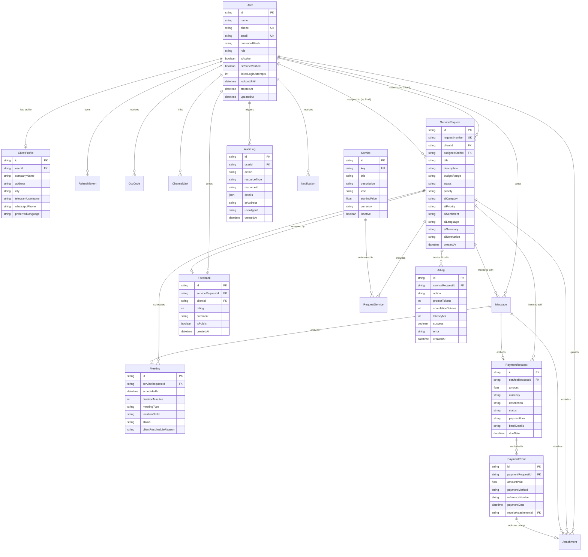

# Database Architecture & Entity-Relationship Diagram

This document models the relational schema of the platform, managed with **Prisma ORM** across PostgreSQL 16. It contains 19 models designed with composite indexes, foreign keys, cascade safety, and audit traceability.

---

## 1. Mermaid Entity-Relationship Diagram

---

## 2. Table Directory & Model Summaries

| Model | Purpose | Primary Key | Key Indexes & Uniqueness |
| :--- | :--- | :--- | :--- |
| `User` | Clients, Staff, Admins, Super Admins | `id` (UUID) | `phone` (unique), `email` (unique) |
| `RefreshToken` | 7-day rotating refresh tokens | `id` (UUID) | `tokenHash` (unique), `userId` |
| `OtpCode` | 6-digit verification & password reset codes | `id` (UUID) | `[phone, purpose, isUsed]` |
| `ClientProfile` | Company name, location, preferred language | `id` (UUID) | `userId` (unique) |
| `ChannelLink` | Telegram chat ID & WhatsApp phone linking | `id` (UUID) | `[channelType, channelUserId]`, `syncCode` |
| `Service` | The 9 technology services catalogue | `id` (UUID) | `key` (unique) |
| `ServiceRequest` | Core customer request ticket | `id` (UUID) | `requestNumber` (unique), `[status, clientId]` |
| `RequestService` | Junction table for multi-service requests | `id` (UUID) | `[serviceRequestId, serviceId]` (unique) |
| `Attachment` | File upload metadata and storage keys | `id` (UUID) | `fileKey` (unique), `serviceRequestId` |
| `Message` | Request conversation threads & internal notes | `id` (UUID) | `serviceRequestId`, `[isReadByClient, isReadByAdmin]` |
| `Meeting` | Online / In-person discovery consultations | `id` (UUID) | `serviceRequestId`, `scheduledAt` |
| `PaymentRequest` | Invoices & milestone payment orders | `id` (UUID) | `serviceRequestId`, `status` |
| `PaymentProof` | CBE / Telebirr transaction slips & ref # | `id` (UUID) | `paymentRequestId`, `referenceNumber` |
| `Feedback` | Post-delivery 1-5 star ratings & testimonials | `id` (UUID) | `serviceRequestId` (unique), `rating` |
| `Notification` | In-app user notifications & read states | `id` (UUID) | `userId`, `isRead` |
| `ReplyTemplate` | Reusable admin canned responses | `id` (UUID) | `category` |
| `AuditLog` | Cryptographic event audit trail | `id` (UUID) | `userId`, `action`, `resourceType`, `createdAt` |
| `Setting` | System-wide banking & configuration values | `id` (UUID) | `key` (unique) |
| `AiLog` | Claude API usage, token counts & latencies | `id` (UUID) | `serviceRequestId`, `action`, `createdAt` |
